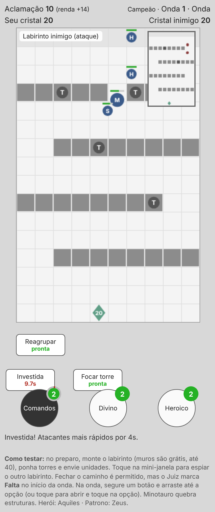
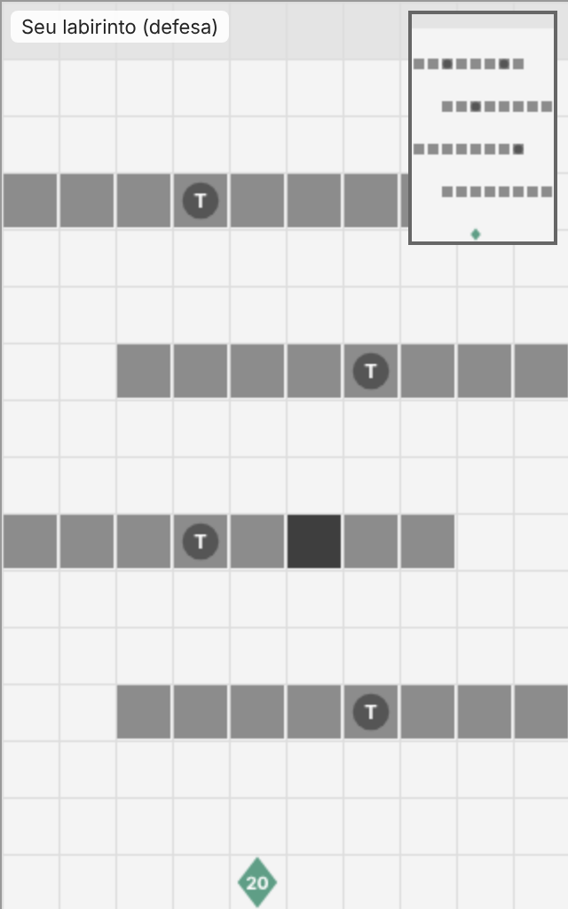
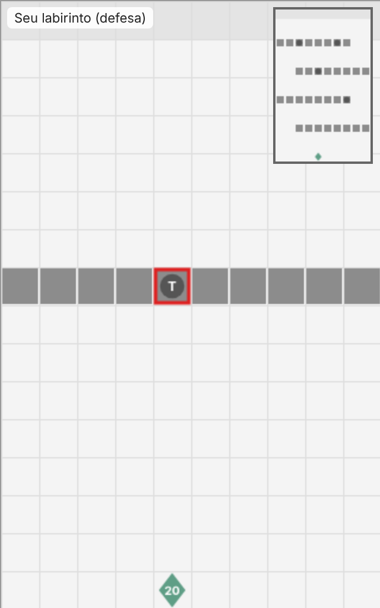
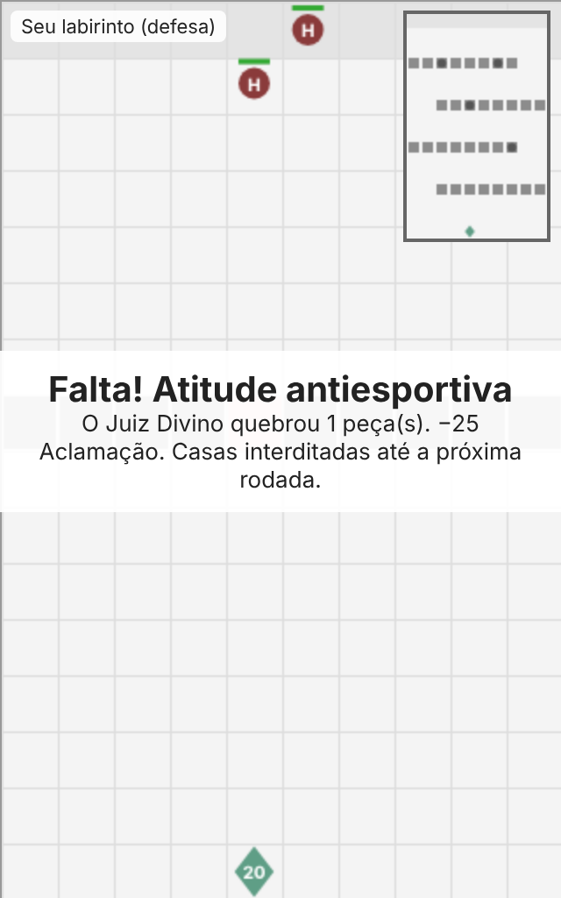

# Jogos de Babel — protótipo cinza v1

> Nome provisório. Tower defense em que heróis mortais, apadrinhados pelos deuses, disputam o "esporte" mais popular de Neo Babylon. Este é um protótipo cinza para testar o ritmo: sem arte, sem som e com números provisórios.

**Jogar:** abra o `index.html` em qualquer navegador, no computador ou no celular.

---

## Objetivo

Cada lado tem um labirinto com um **cristal** no fim. Você defende o seu e manda unidades para destruir o do adversário. Quem zerar o cristal do outro primeiro vence. Os dois cristais começam com **20 de vida**.

## Como uma partida funciona

A partida alterna duas fases até um cristal cair:

1. **Preparo** (sem tempo limite)
   - Monte ou redesenhe o seu labirinto.
   - Escolha quais unidades vão para o ataque.
   - Salve ou carregue um layout de labirinto.
2. **Onda** (tempo real)
   - As unidades dos dois lados saem ao mesmo tempo, uma a cada 0,7 s por lado.
   - Sua defesa funciona sozinha. Você interfere pelos três botões de habilidade.
   - A onda acaba quando não sobra nenhuma unidade nos dois labirintos.

### Tela

- Na onda, a câmera mostra o **labirinto inimigo** (onde estão as suas unidades).
- A **mini-janela** no canto mostra o outro labirinto. Toque nela para trocar a câmera.
- A mini-janela **pisca em vermelho** quando o seu cristal leva dano.



---

## O labirinto

O grid tem **10 × 16 casas**. As unidades entram pela linha de cima (cinza) e procuram sempre o **caminho mais curto** até o cristal. A linha de largada e a casa do cristal não aceitam construção.

| Estrutura | Vida | Custo | Observação |
|---|---|---|---|
| Muro | 40 | grátis | Até 40 muros no labirinto |
| Torre | 80 | 40 de Aclamação | Substitui a peça e passa a fazer parte do labirinto |
| Muralha reforçada | 200 | 30 de Aclamação | Só faz diferença contra unidades que quebram estruturas |

- No preparo, **Apagar** devolve 100% do custo.
- Colocar torre ou muralha em cima de um muro troca a peça; o muro sai do limite.
- **Exemplo de labirinto em serpentina:** quatro fileiras de muros com a passagem alternando entre os lados obrigam o inimigo a percorrer o mapa inteiro. As torres ficam nas fileiras, perto das curvas, e a muralha reforçada protege um ponto que o Minotauro ataca com frequência.



### Torres

| Atributo | Valor |
|---|---|
| Dano | 8 por tiro |
| Cadência | 1 tiro a cada 0,6 s |
| Alcance | 2,6 casas |
| Alvo | a unidade mais próxima do cristal |

---

## A Falta

Fechar o caminho é **permitido**, mas tem preço.

- **No preparo:** se o caminho estiver fechado, as peças que o Juiz vai quebrar aparecem contornadas em vermelho.
- **No início da onda:** o **Juiz Divino** quebra as peças que abrem o caminho com menos quebras. A escolha é sempre a mesma para o mesmo labirinto, sem sorte envolvida.
- **Punição:** −25 de Aclamação por peça quebrada. As casas ficam **interditadas** (vermelho claro) durante o próximo preparo.

 

*Na arquibancada: "Ih, o cara fechou tudo! Lá vem o Juiz... Falta! Atitude antiesportiva! A galera vaiou feio e ele perdeu a casa até a próxima rodada."*

---

## Unidades de ataque

| Unidade | Vida | Velocidade (casas/s) | Custo | Renda por envio | Dano ao cristal | Especial |
|---|---|---|---|---|---|---|
| Hoplita (H) | 60 | 1,3 | 20 | +3 | 1 | — |
| Sátiro (S) | 30 | 2,3 | 15 | +2 | 1 | Rápido e frágil |
| Minotauro (M) | 170 | 0,8 | 45 | +6 | 2 | Quebra estruturas (25 de dano/s) |

- O **Minotauro** calcula a rota considerando atravessar estruturas: quanto mais vida a peça tem, mais "longo" fica passar por ela. Ele pode tanto dar a volta quanto abrir caminho na marra. Quando uma peça cai, todas as unidades recalculam a rota.
- As unidades **inimigas** ganham vida a cada onda, de acordo com a dificuldade (ver abaixo).

---

## Habilidades (Herói Aquiles + Patrono Zeus)

Três botões, cada um abre um **leque** com no máximo 3 opções. Segure o botão e arraste até a opção, ou toque para abrir e toque na opção.

O **selo** em cada botão mostra quantas habilidades estão prontas. A cor vai do vermelho (recém-usada) ao verde (pronta), e o anel enche conforme a recarga avança.

| Botão | Habilidade | Recarga | Efeito |
|---|---|---|---|
| Comandos | Investida | 10 s | Suas unidades ficam 70% mais rápidas por 4 s |
| Comandos | Reagrupar | 14 s | Cura 40% da vida máxima das suas unidades |
| Comandos | Focar torre | 15 s | Atordoa por 4 s as 2 torres inimigas mais próximas da sua unidade da frente |
| Divino | Raio | 18 s | 35 de dano em todos os invasores do **seu** labirinto |
| Divino | Bênção | 30 s | Suas unidades ficam imunes por 3 s |
| Heroico | Golpe show | 12 s | 60 de dano na torre inimiga mais próxima da sua unidade da frente; **+20 Aclamação** |
| Heroico | Grito | 16 s | Torres inimigas atiram na metade da velocidade por 5 s; **+5 Aclamação** |

As habilidades de show (Golpe show e Grito) pagam Aclamação: a plateia gosta de espetáculo.

---

## Economia: Aclamação

A **Aclamação** é o único recurso. Ela paga torres, muralhas e unidades de ataque.

**Ganho no fim de cada onda:**

```
ganho = base + renda + juros
juros = 10% da Aclamação guardada (o cálculo para em 300 guardados)
```

| Fonte | Valor |
|---|---|
| Base | depende da dificuldade (30 a 45) |
| Renda | soma acumulada de todas as unidades que você já enviou (permanente) |
| Juros | até +30 por onda |
| Invasor derrotado no seu labirinto | +2 cada |
| Golpe show / Grito | +20 / +5 |
| Falta | −25 por peça quebrada |

**A decisão central:** cada unidade enviada custa agora, mas aumenta a renda para sempre. Gastar tudo em torres segura a defesa, mas deixa a economia parada. Guardar rende juros, mas te deixa mais fraco na onda seguinte.

*Exemplo de rodada: "Tô com 120. Mando dois Hoplitas (−40), minha renda sobe +6 pra sempre. Sobram 80: boto uma torre na curva e guardo 40 pros juros. Na volta entram 38 de base, +renda, +4 de juros... dá pra respirar."*

---

## Dificuldades do NPC

Escolha antes da primeira onda.

| | Aprendiz | Campeão | Lenda |
|---|---|---|---|
| Aclamação inicial | 220 | 190 | 160 |
| Base por onda | 45 | 38 | 30 |
| Vida extra dos invasores por onda | 0% | +5% | +10% |
| Hoplitas na onda *n* | 2 + 0,75·*n* | 3 + *n* | 3 + 1,5·*n* |
| Sátiros na onda *n* | 2 a cada 3 ondas | 2 a cada 2 ondas | 2 a cada 2 ondas |
| Minotauros | *n*/3 nas ondas múltiplas de 3 | idem | idem, mais *n* − 4 a partir da onda 5 |
| Defesa do NPC melhora | a cada 3 ondas | a cada 2 ondas | toda onda |

**Defesa do NPC:** começa com um labirinto em serpentina e 4 torres. A cada melhoria, um muro vira torre. Quando a melhoria cai numa onda múltipla de 4, um muro também vira muralha reforçada (ondas 4, 8, 12… no Lenda; 4, 8… no Campeão; 12, 24… no Aprendiz).

**Calibração (bots automáticos que misturam ataque e defesa):**

| Uso de habilidades | Aprendiz | Campeão | Lenda |
|---|---|---|---|
| Perfeito | vence (onda 7) | vence (onda 6) | vence (onda 7) |
| A cada 10 s | vence (onda 8) | vence (onda 8) | perde (onda 8) |
| Nunca | vence (onda 15) | perde (onda 8) | perde (onda 6) |

---

## O que ainda não está no protótipo

- Montagem do deck por peso (hoje as unidades e estruturas são fixas).
- Escolha de herói e de deus patrono (hoje é sempre Aquiles + Zeus).
- Trapaças dos patronos trapaceiros e o medidor de Suspeita.
- Ranking de favoritismo (favorito × azarão).
- Arenas com regras próprias.
- PvP (planejado para a v2, de forma assíncrona).

## Feedback

Ao testar, observe principalmente:

1. Segurar e arrastar funciona bem no celular durante a onda?
2. A mini-janela basta para cuidar da defesa, ou você fica trocando de câmera?
3. As habilidades pesam demais no resultado?
4. Em quantas ondas a partida fica boa? Muito curta, muito longa?
